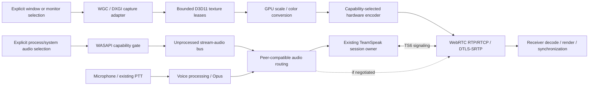

# Native streaming direction and interoperability gates

Date: 2026-11-12. This records the owner's requested direction and verified
research. A standalone owned-window capture probe now validates WGC and GPU
texture copies; native application capture/encoding is not integrated or benchmarked.
The [synthetic media experiment](persistent-chat-and-streaming-research.md)
is the current media evidence. Central contacts/groups remain deferred.

## Architecture

Preserve the existing `!Send` protocol owner and local bridge security boundary.
Capture, encoder and media transport must not block its event polling. Each
queue needs a frame/byte bound and timestamps; backpressure must not turn a
temporary stall into seconds of permanent delay. This diagram does not assert
that stream audio is already supported inside the official peer's WebRTC path.

## Capture and GPU ownership

Candidate: `windows-capture` 2.0.1, MIT. Its crate archive was downloaded from
the official registry and SHA-256 verified against registry metadata, then
inspected without compiling or executing it. Public source has WGC and DXGI
modules. `Frame` exposes `as_raw_surface`, `as_raw_texture`, `device`,
`device_context` and `desc`. Its `buffer()` path explicitly copies to a
CPU-readable staging texture and maps it; avoid that path in a GPU-resident
pipeline. The encoder includes a Direct3D surface sample path, but is oriented
around Windows media transcoding/containers. That is not a verified source of
low-latency elementary H.264 access units for a WebRTC sender.

References: [crate](https://docs.rs/crate/windows-capture/2.0.1),
[published source](https://docs.rs/crate/windows-capture/2.0.1/source/),
[Microsoft WGC guidance](https://learn.microsoft.com/en-us/windows/apps/develop/media-authoring-processing/screen-capture).
Some docs.rs version-specific API pages were inaccessible through the web tool;
the registry archive supplied the source-level evidence above.

Use a capture abstraction that preserves format, dimensions, timestamp, adapter
identity and resource lifetime. A GPU-to-GPU texture copy may be necessary;
the objective is to avoid full-frame CPU readback, not claim that no copy occurs.
Do not retain a returned capture-pool surface after its lease expires. Own an
appropriate GPU resource and synchronize capture/conversion/encode completion.
Validate adapter/device compatibility, formats and shared-resource support.
Multi-adapter and device-loss behavior require explicit tests, not assumptions.

WGC is the first window-capture candidate, DXGI a monitor-capture candidate.
Changing API may preserve the same selected source; changing a window to its
entire monitor broadens the captured content and requires a new user selection.
Do not silently use whole-monitor capture as a window fallback. Exclusive
fullscreen and protected-content behavior remain unverified. Graphics hooks
are a separate optional research area, never the default or an anti-cheat bypass.

## Audio capabilities and routing

[Microsoft's process-loopback sample](https://github.com/microsoft/Windows-classic-samples/blob/main/Samples/ApplicationLoopback/README.md)
requires Windows build 20348 or later. It can include or exclude a process tree;
it captures process audio, not a uniquely identified browser tab or window.
This minimum excludes some widely used Windows 10 builds. Check OS/API support
at runtime and return an explicit unsupported capability where appropriate.
Do not silently replace process-only capture with all system audio.

Keep microphone/voice processing separate from game/system audio. The proposed
voice AEC/NS/AGC path needs a valid render reference, delay alignment, clipping
tests and CPU measurements. The existing suppression implementation does not
establish acoustic echo cancellation. Avoid processing music/game output as
speech by default. Process selection must account for subprocesses and PID
reuse. Full-system capture needs explicit selection and a tested strategy to
avoid recapturing the client's own output; do not promise per-process exclusion
on an unsupported OS.

The official-peer reference currently suggests an inactive WebRTC audio
transceiver and audio routed through the voice path. Validate actual official
peer behavior before introducing a second WebRTC audio track or mixing stream
audio into voice. Neither routing nor A/V synchronization is proven by the
silent synthetic video experiment.

## Encoder and receiver strategy

Prefer capability-detected NVENC, AMF or Quick Sync, with Media Foundation or
software considered as explicit fallback implementations. A detected GPU name
does not prove encoder initialization or a working capture/encode combination.
The [NVIDIA programming guide](https://docs.nvidia.com/video-technologies/video-codec-sdk/13.1/nvenc-video-encoder-api-prog-guide/index.html)
describes resource registration, mapping and synchronization; evaluate matching
AMD/Intel interfaces before making cross-vendor claims.

H.264 is the initial native-codec candidate, subject to the official peer's
negotiated profile/level and packetization mode. VP8 is the current synthetic
experiment's configured codec. AV1, HEVC and VP9 are future negotiated options,
not automatic capabilities. Keep capture and transmit resolutions separate.
Bound encoder output queues; honor keyframe requests and codec reference
dependencies. Do not drop arbitrary encoded delta frames and assume the next
frame is decodable. Resolution/bitrate changes, B-frames, keyframe interval,
HDR color metadata and tone mapping each require their own compatibility tests.

The receiver needs codec-specific depacketization, feedback, jitter handling,
decode, render and timestamp alignment. GPU decode/render and bounded recovery
after loss must be measured independently of encoder speed.

## WebRTC stack decision gate

| Candidate | Evidence and tradeoff |
| --- | --- |
| webrtc-rs | Initial native transport candidate for existing Rust/Tokio architecture; upstream examples send pre-encoded media. Capture, GPU codecs and render integration still belong to Mirage |
| str0m 0.25.0 | Sans-I/O and explicit driving are useful for a customized engine, but its own feature comparison excludes capture, encode/decode, adaptive jitter buffer and TURN; not a complete replacement for those components |
| libwebrtc bindings | Comparison candidate for a more integrated media engine; native build, ABI, licensing and hardware-texture access costs need a spike |

Sources: [webrtc-rs](https://github.com/webrtc-rs/webrtc),
[examples](https://github.com/webrtc-rs/webrtc/blob/master/examples/README.md),
[str0m feature comparison](https://docs.rs/crate/str0m/0.25.0).
No native WebRTC dependency has been selected, installed or benchmarked yet.
Do not select a pre-release accidentally from an unpinned upstream branch.

Continue using TeamSpeak's stream signaling. The local bridge may carry
structured controls, but a new standalone signaling server would not by itself
interoperate with official TeamSpeak clients. STUN is not TURN. Relay mode
requires configured TURN service/credentials and a strict relay-only policy;
it must not fall back to direct candidates. SFU is a later, deployment-specific
capability: validate TeamSpeak's negotiated mode and service support before
introducing one. A Mirage-only SFU path would need to be described separately.

OBS and Sunshine are technical references, not default dependencies. Their
repositories identify GPL licensing, so copying/linking requires a dedicated
license review; no code was copied here. See [OBS](https://github.com/obsproject/obs-studio)
and [Sunshine](https://github.com/SunshineStream/Sunshine). Do not adopt their
application protocol as a replacement for TeamSpeak interoperability.

## Next proof gates

The [native capture probe](../recon/probe-capture/README.md) now covers an owned
synthetic window, GPU copy ownership and resizing. It exposed a fixture-style
startup error, which was reproduced and corrected. Minimize, device loss and
capture recovery remain open; this is not completion of the full first gate.

The same isolated probe now converts its final owned texture to NV12 using
D3D11 video processing and submits twenty repeated GPU-surface samples to a
Media Foundation H.264 file writer. Independent FFprobe/FFmpeg verification
confirmed twenty 640x360 frames at 20 FPS and the synthetic fixture color.
Explicit BT.709 metadata was necessary for the color check. A follow-up walks
the sink writer's transform chain and reports that MF inserted a hardware H.264
encoder MFT on the test workstation (repeated three times); the executing
adapter on multi-GPU systems is still unrecorded. This does
not yet produce streaming access units or benchmark a live encode queue; see
the [probe record](../recon/probe-capture/README.md#gpu-input-h264-diagnostic).

Direct-MFT follow-up: the probe now drives H.264, HEVC and AV1 encoder MFTs
without the sink writer and emits raw access units. All three encoded on
hardware here; dimensions were read by Mirage's own bitstream parser, RTP
packetization (RFC 6184/7798, AV1 RTP) round-tripped losslessly at MTU 1200,
and the OS H.264 decoder reproduced the fixture colour. No FFmpeg is involved.
HEVC/AV1 decoders were absent, so codec selection must follow the viewer's
decode capabilities with H.264 as baseline. Encoders on other adapters reject
the capture device; select by adapter LUID (`MFTEnum2`). Details in the
[probe record](../recon/probe-capture/README.md#direct-mft-multi-codec-stream-diagnostic---stream).

Live RTP follow-up: two processes now stream a moving pattern over loopback
UDP in real time (20 FPS) for H.264, HEVC and AV1, all hardware-encoded with a
requested 20-frame GOP honoured. 60/60 frames arrived with no loss; a
deliberate single-packet drop was detected, the damaged frame discarded and
playback resumed cleanly at the next keyframe. Next protocol work: RTCP PLI
for immediate recovery, NACK/congestion control, and SRTP/DTLS; then
cross-machine and official-viewer tests.

Encoder choice follow-up: users can pick backend (GPU hardware / CPU
software / auto) and GPU (high-performance, power-saving or an index) per
codec. Encoders are matched to adapters by LUID; an explicit GPU choice is never
silently replaced by another GPU. Encoding on a non-capture GPU or the CPU adds
a measured per-frame copy. Low-latency mode and zero B-frames are requested
explicitly — without them one integrated-GPU HEVC encoder buffered ~100 ms. See
the [probe record](../recon/probe-capture/README.md#choosing-the-encoder-gpu-integrated-gpu-or-cpu).

1. Measure GPU-texture capture/ownership on an explicitly selected synthetic
   window, including resize, minimize, device loss and stopping capture.
2. Encode synthetic GPU frames and produce bounded elementary bitstreams; record
   actual adapter, format, codec, copies, queue depth and encode-time percentiles.
3. Decode in an official TeamSpeak viewer using the validated TS6 signaling path.
4. Measure cross-machine P2P, loss/RTT adaptation, and configured TURN fallback.
5. Add capability-gated process/system audio and synchronization experiments.
6. Add resolution/FPS/HDR tiers only after the entire path passes. Preset bitrate
   values are proposed starting points, not performance or quality guarantees.

Shared reports must omit workstation identifiers, endpoints and user captures.
Use synthetic fixtures for exported evidence; keep device-specific records local.
