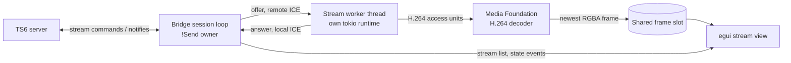

# Stage 1: watching TS6 screen streams in the native client

Date: 2026-11-13. Status: implemented, but **not working against the official
client yet** (the connection never completes). See "Native viewer against the
official client" in `docs/persistent-chat-and-streaming-research.md`.
Deviations made during implementation: the audio m-line is accepted (and
ignored) instead of declined, re-offers sent through `streamsignaling` are
answered, and the worker command queue holds 66 entries instead of 8.

## Goal

A Mirage desktop user in a voice channel sees who is streaming, clicks
"Assistir", and watches that person's screen inside Mirage. The first
acceptance target is a stream published by the **official TS6 client**.
Mirage-to-Mirage watching follows automatically once stage 2 (publishing)
exists, because both use the same WebRTC offer/answer path.

This is stage 1 of four:

1. Watch a stream (this spec).
2. Publish from Mirage with a Discord-style source picker.
3. Discord-style viewing layout (live badge polish, focus/strip, fullscreen,
   pop-out, own preview).
4. Stream audio, several viewers, network recovery.

## Evidence this design rests on

`ts6-cli stream-offer` (spike, 2026-11-13) joined `Default Channel` on the
owner's beta13.1 server while a friend shared a screen from the official
client:

- `notifystreamstarted` arrived; `joinstreamrequest` was **admitted
  automatically** (`decision=1`) with a 3.6 KB SDP offer.
- The offer is libwebrtc-shaped: `BUNDLE 0 1`, `a=setup:actpass`,
  `rtcp-mux`, trickle ICE, `transport-cc`, `goog-remb`, `nack`, `nack pli`,
  `ccm fir`, video-content-type and color-space header extensions.
- Video payloads, in preference order: AV1 (39), H.264 High
  `profile-level-id=640c1f` with `packetization-mode=1` (102) and `=0` (104),
  VP9 (98), VP8 (96), plus rtx, red and ulpfec.
- A second m-line carries stream audio: Opus 48 kHz stereo (111), sendonly.
- The SDP had no candidates; 30 `iceCandidate` messages followed through
  `notifystreamsignaling` (JSON `{"cmd","args":{"sdp","mid","mLine"}}`).
- The server reports `client_is_streaming`; the vendored book already
  models it as `IsStreaming`.

Earlier work (PR #7) proved the stream-control state machine against this
server and decoded synthetic VP8 between two Chromium peers. Probe records
show the Windows H.264 decoder is present and AV1/HEVC decoders are not on
the test workstation.

## Decisions

- **Codec: H.264, packetization-mode=1 only.** It is the one offered codec
  every Windows 10/11 machine can decode through Media Foundation (hardware
  where the GPU supports it). AV1/VP9/VP8 are rejected in the answer.
- **Stream audio is declined in stage 1** (audio m-line answered with port 0).
- **WebRTC stack: `webrtc` (webrtc-rs) 0.21.x**, MIT/Apache-2.0, pure Rust.
  It handles ICE, DTLS-SRTP, BUNDLE, rtcp-mux, NACK and RTCP feedback, and
  provides an H.264 RTP depacketizer. Fallback if interop with libwebrtc
  fails at the DTLS or ICE gate: LiveKit's `libwebrtc` bindings (heavier,
  prebuilt Google WebRTC). The fallback is a separate decision, not part of
  this plan.
- **Video never crosses the WebSocket.** The desktop embeds the bridge in its
  own process; decoded frames go through an in-process shared slot. The React
  frontend does not get video in stage 1.

## Architecture

### Units

| Unit | Location | Job |
|------|----------|-----|
| Streaming flag | `ts6-core/src/state.rs` | `ClientInfo.is_streaming` from the book's `IsStreaming` |
| Stream notices | `ts6-core/src/streams.rs` (exists) | Typed parse of start/stop/join-response/signaling |
| Stream registry + signaling | `ts6-bridge/src/streams.rs` (new) | Stream id per publisher; watch/unwatch commands; relays offer, answer and ICE between session loop and worker; deadlines |
| SDP answer policy | `ts6-bridge/src/stream_media/sdp.rs` (new) | Pure function: from an offer's capabilities, pick H.264 pm=1 and decline everything else; bounded sizes |
| Stream worker | `ts6-bridge/src/stream_media/mod.rs` (new) | One webrtc-rs peer connection per watched stream on a dedicated thread; depacketizes H.264 |
| Decoder | `ts6-bridge/src/stream_media/decode.rs` (new) | Media Foundation H.264 MFT → BGRA/RGBA, scaled to at most 1920 px wide |
| Frame slot | `ts6-bridge/src/stream_media/frame.rs` (new) | `Arc<Mutex<Option<Frame>>>` keyed by stream; newest frame wins; frame counter |
| Protocol | `ts6-bridge/src/protocol.rs`, desktop `protocol.rs` | Commands `WatchStream{client}`, `StopWatching`; events `Streams{...}`, `StreamState{client, state, reason}` |
| UI | `apps/desktop/src/app.rs`, `strings.rs` | "AO VIVO" badge, "Assistir" action, stream view with close button, pt-BR errors |

Each unit is testable alone: the SDP policy and registry are pure logic; the
worker is exercised by a loopback test with a second webrtc-rs peer; the
decoder by decoding a known H.264 fixture.

### Data flow (watch)

1. A `notifystreamstarted` (or `IsStreaming` on a client already in the
   channel, followed by `requeststreaminfo` to learn the id) adds a stream to
   the registry; the UI shows "AO VIVO" on that participant's card.
2. "Assistir" sends `WatchStream{client}`. The session loop sends
   `joinstreamrequest id clid msg="" is_remove=0`.
3. `notifyrespondjoinstreamrequest decision=1 offer=...` hands the offer to
   the worker. The worker applies the answer policy, creates the answer and
   the session loop sends it as `streamsignaling json={"cmd":"answer",...}`.
4. Remote `iceCandidate` messages are applied as they arrive; local
   candidates are sent the same way. Candidate count is bounded (64).
5. H.264 RTP → access units → decoder → newest frame into the slot →
   `ctx.request_repaint()` through a repaint callback registered by the UI.
6. Closing the view, the stream stopping, leaving the channel or
   disconnecting tears down: `joinstreamrequest is_remove=1` (when still
   connected), peer connection closed, decoder dropped, slot cleared.

### Threading and bounds

- The session loop stays the only owner of the `!Send` session; it never
  awaits WebRTC work. It talks to the worker over bounded channels (8 commands,
  64 events) with `try_send`; a full queue fails that stream, not the voice.
- The worker owns a current-thread tokio runtime on its own OS thread, like
  the diagnostic owners.
- Decoding runs on the worker thread, never on the UI thread. The slot holds
  one frame; a slow UI simply sees fewer frames. Decoder input is bounded to
  a few access units; on overflow, frames are dropped until the next keyframe
  and a PLI is sent.
- Size bounds: offer ≤ 16 KiB, each ICE JSON ≤ 2 KiB, decoded frame ≤ 1920 px
  wide after scaling.

### Errors (pt-BR in the UI)

| Condition | Behavior |
|-----------|----------|
| Join refused (`decision=0`) | "A transmissão recusou o pedido." |
| No offer / no answer path in 15 s | "A transmissão não respondeu." |
| Offer without H.264 pm=1 | "Formato de vídeo não suportado." |
| ICE fails / no frame within 20 s of connecting | "Não foi possível conectar à transmissão (rede bloqueada?)." |
| Decoder unavailable | "Seu Windows não tem decodificador H.264." |
| Stream stops while watching | View closes with "A transmissão terminou." |

SDP, ICE candidates, fingerprints and stream payloads are never logged; only
counts and states, as in the existing diagnostics.

## Testing

- Unit: SDP answer policy against the captured offer's shape (synthetic copy
  with secrets replaced), including offers without H.264 and with only pm=0.
- Unit: registry state machine (start, stop, watch, refusal, timeout, stale
  events after disconnect).
- Integration (local): two webrtc-rs peers on loopback, publisher sending a
  short H.264 fixture; viewer decodes ≥5 frames with the expected color.
- Live (owner + friend): official TS6 publishes in `Default Channel`; Mirage
  watches; record frames decoded, time to first frame, and teardown. Then
  repeat across two different homes/networks.
- Existing checks: `check_repository.py`, workspace build, tests, fmt,
  clippy `-D warnings`.

## Risks

1. webrtc-rs ↔ libwebrtc DTLS/ICE interop: verified first, with the
   integration test and the live test, before any UI work is polished.
2. NAT: without STUN/TURN the connection may fail across homes. The official
   offer's candidates show what the server relays; if host/srflx is not
   enough, adding a public STUN server is a follow-up decision.
3. H.264 High profile 4:2:0 decoding in the Windows MFT is expected to work;
   verified with the fixture test.
4. New dependency tree size and license review of `webrtc` 0.21.x is part
   of the plan's first task.

## Out of scope

Publishing, the source picker, stream audio, fullscreen/pop-out, several
simultaneous streams, the React frontend, and myTeamSpeak/group-call streams.
